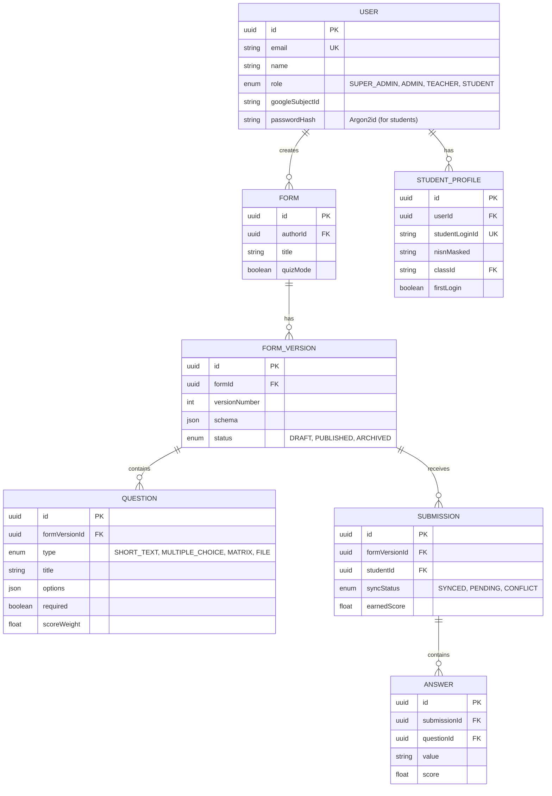

# Sistem Formulir, Kuis, dan Penilaian SDN 268 Panyileukan
## Arsitektur & Blueprint Backend

### 1. Struktur Monorepo (Konseptual)
```text
/
├── apps/
│   ├── web/               # Next.js App Router (Frontend & PWA)
│   └── api/               # Node.js Express (REST API)
├── packages/
│   ├── shared/            # Zod schemas, Typescript interfaces
│   ├── config/            # ESLint, TSConfig, Prettier
│   └── ui/                # shadcn/ui components
├── docker-compose.yml
└── package.json           # npm/pnpm workspaces
```

### 2. Entity Relationship Diagram (ERD)


### 3. Skema Prisma (`schema.prisma`)
```prisma
datasource db {
  provider = "postgresql"
  url      = env("DATABASE_URL")
}

generator client {
  provider = "prisma-client-js"
}

enum Role {
  SUPER_ADMIN
  ADMIN
  TEACHER
  STUDENT
}

enum FormStatus {
  DRAFT
  PUBLISHED
  ARCHIVED
}

model User {
  id              String   @id @default(uuid())
  email           String?  @unique
  name            String
  role            Role
  googleSubjectId String?  @unique
  passwordHash    String?
  createdAt       DateTime @default(now())
  updatedAt       DateTime @updatedAt

  forms           Form[]
  studentProfile  StudentProfile?
  submissions     Submission[]
}

model StudentProfile {
  id             String  @id @default(uuid())
  userId         String  @unique
  studentLoginId String  @unique
  nisnMasked     String
  class          String
  firstLogin     Boolean @default(true)
  user           User    @relation(fields: [userId], references: [id])
}

model Form {
  id        String        @id @default(uuid())
  authorId  String
  title     String
  quizMode  Boolean       @default(false)
  author    User          @relation(fields: [authorId], references: [id])
  versions  FormVersion[]
}

model FormVersion {
  id            String       @id @default(uuid())
  formId        String
  versionNumber Int
  status        FormStatus   @default(DRAFT)
  form          Form         @relation(fields: [formId], references: [id])
  questions     Question[]
  submissions   Submission[]

  @@unique([formId, versionNumber])
}

model Question {
  id            String      @id @default(uuid())
  formVersionId String
  type          String      // SHORT_TEXT, MULTIPLE_CHOICE, MATRIX, etc.
  title         String
  options       Json?       // For multiple choice or matrix columns
  required      Boolean     @default(true)
  scoreWeight   Float?
  answerKey     String?
  formVersion   FormVersion @relation(fields: [formVersionId], references: [id])
  answers       Answer[]
}

model Submission {
  id            String      @id @default(uuid())
  formVersionId String
  studentId     String
  syncStatus    String      @default("SYNCED")
  earnedScore   Float?
  submittedAt   DateTime    @default(now())
  
  formVersion   FormVersion @relation(fields: [formVersionId], references: [id])
  student       User        @relation(fields: [studentId], references: [id])
  answers       Answer[]
}

model Answer {
  id           String     @id @default(uuid())
  submissionId String
  questionId   String
  value        String     // JSON stringified for complex answers (matrix/files)
  score        Float?
  
  submission   Submission @relation(fields: [submissionId], references: [id])
  question     Question   @relation(fields: [questionId], references: [id])
}
```

### 4. Konfigurasi Docker (`docker-compose.yml`)
```yaml
version: '3.8'

services:
  db:
    image: postgres:15-alpine
    environment:
      POSTGRES_USER: root
      POSTGRES_PASSWORD: rootpassword
      POSTGRES_DB: sdn268_db
    ports:
      - "5432:5432"
    volumes:
      - pgdata:/var/lib/postgresql/data

  api:
    build: 
      context: .
      dockerfile: apps/api/Dockerfile
    ports:
      - "4000:4000"
    environment:
      DATABASE_URL: postgresql://root:rootpassword@db:5432/sdn268_db?schema=public
      JWT_ACCESS_SECRET: secret
    depends_on:
      - db

  web:
    build:
      context: .
      dockerfile: apps/web/Dockerfile
    ports:
      - "3000:3000"
    environment:
      NEXT_PUBLIC_API_URL: http://localhost:4000/api/v1
    depends_on:
      - api

volumes:
  pgdata:
```

### 5. Strategi Sinkronisasi Offline
1. **Penyimpanan Lokal:** Frontend menggunakan `Dexie.js` untuk membuat database IndexedDB lokal (tabel: `cachedForms`, `draftSubmissions`, `mutationQueue`).
2. **Koneksi Terputus:** Saat mengisi formulir offline, data disimpan ke `draftSubmissions`. Saat murid menekan "Kirim", payload masuk ke `mutationQueue` dengan status `PENDING`.
3. **Koneksi Kembali:** Listener `window.addEventListener('online')` memicu worker yang membaca `mutationQueue`. Request dikirim ke `POST /api/v1/sync/batch` lengkap dengan `clientMutationId` (UUID) untuk mencegah duplikasi (Idempotency).
4. **Resolusi Konflik:** Backend memeriksa `updatedAt` lokal vs server. Jika terjadi konflik pada draft, status dikembalikan sebagai `CONFLICT` dan UI meminta murid memilih versi mana yang dipertahankan.