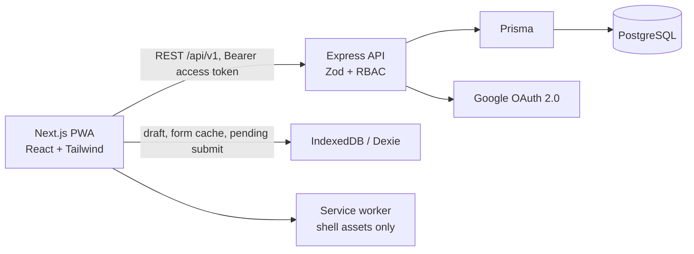

# Arsitektur

Monorepo memakai npm workspaces. `packages/shared` menyimpan schema Zod dan helper domain untuk mengurangi perbedaan validasi klien/server. API menggunakan envelope JSON konsisten, autentikasi access token singkat, refresh token yang disimpan sebagai hash di database dan dikirim melalui cookie HttpOnly, serta validasi ownership pada operasi form dan penilaian yang tersedia.

## Data dan versi

`Form` menyimpan identitas serta status publikasi; setiap perubahan melalui endpoint edit membuat `FormVersion` baru. Schema pertanyaan disimpan sebagai JSON tervalidasi. Submission menunjuk versi tertentu agar perubahan di masa depan tidak mengubah jawaban lama. Jawaban dan payload sync disimpan JSON untuk MVP; struktur relasional tambahan dapat dipecah saat matriks/berkas diimplementasikan.

## Keputusan MVP

- Postgres adalah sumber data utama; tidak ada mock database.
- IndexedDB menyimpan cache form, draft, mutation pending, dan log sinkronisasi. Token akses hanya berada di `sessionStorage`, tidak di Cache Storage.
- Setiap submit membawa UUID `clientMutationId`, diberi unique constraint dan diperiksa kembali pada server.
- Service worker menyimpan app shell/aset satu origin; API tidak dicache.
- Upload berkas, assignment filtering, dan resolusi konflik lintas perangkat belum aktif. Detail batasan lihat [OFFLINE_SYNC.md](./OFFLINE_SYNC.md).
