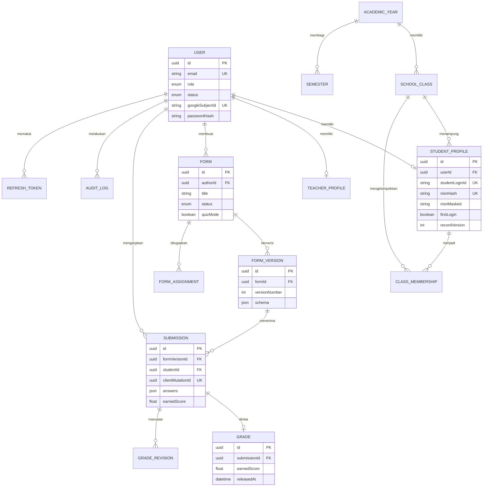

# ERD

Schema lengkap tersedia di `apps/api/prisma/schema.prisma`. Entitas `UploadedFile`, `ImportJob`, dan `ImportError` belum ada karena fitur upload dan import belum diterapkan; jangan menganggap diagram ini mencakup fitur tersebut.
